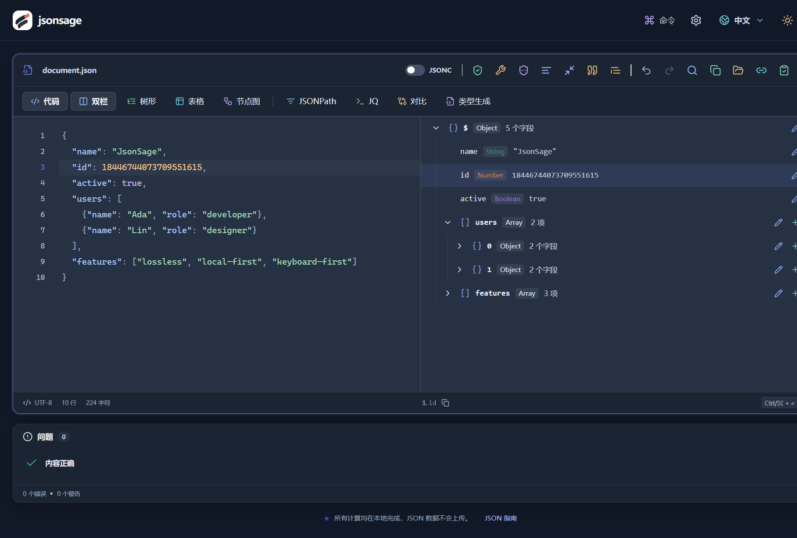

<p align="center">
  
</p>

<h1 align="center">JsonSage</h1>

<p align="center"><strong>看清 JSON，保持精度，数据留在本地。</strong></p>
<p align="center">基于 CodeMirror 6 的 JSON / JSONC 网页工具：编辑、查询、对比与类型生成，全部在浏览器中完成。</p>
<p align="center"><sub>A local-first JSON / JSONC toolbox for the browser: edit, query, diff and generate types without uploading your data.</sub></p>

<p align="center">
  <a href="https://github.com/zhanpoint/jsonsage/actions/workflows/deploy.yml"></a>
  <a href="LICENSE"></a>
  
  
  <a href="https://codemirror.net/"></a>
  <a href="#隐私与离线"></a>
</p>

<p align="center">
  <a href="https://jsonsage.dreamlog.xyz/">在线使用</a> ·
  <a href="#快速开始">快速开始</a> ·
  <a href="#功能一览">功能一览</a> ·
  <a href="#使用指南">使用指南</a> ·
  <a href="#部署">部署</a> ·
  <a href="#开发与贡献">参与贡献</a>
</p>

<p align="center">
  
</p>

<p align="center"><sub>演示动画（25 秒）。<a href="docs/demo.mp4">下载 MP4 高清版</a></sub></p>



<p align="center"><sub>真实界面：选择树节点，代码和底部路径同步定位。截图使用演示数据。</sub></p>

## 为什么用 JsonSage

- **保留长整数**：格式化、压缩、树形展示、JSONPath 和结构对比都保留数字原文，雪花 ID 不会变成另一串数字。
- **减少等待**：CodeMirror 虚拟视口、虚拟滚动与 Web Worker 分担编辑、计算和渲染；大文件采用分支浏览和分页。
- **用熟悉的方式看数据**：代码、树形、表格、节点图随时切换，双栏模式让代码与树节点相互定位。
- **从问题到结果**：精确到行列的诊断、一键修复、JSONPath / JQ 查询和结构对比，覆盖常见调试流程。
- **键盘优先**：命令面板、默认快捷键、自定义键位；格式化和复制结果遵循设置的缩进。
- **数据留在本地**：无后台解析、无分析脚本；生产版支持 PWA 安装和离线使用。

## 快速开始

**环境要求**：Node.js 24 LTS（含 npm）和 Git。无需数据库、API Key 或后端服务。

```sh
git clone https://github.com/zhanpoint/jsonsage.git
cd jsonsage
npm ci
npm run dev
```

打开 [http://127.0.0.1:5174](http://127.0.0.1:5174) 即可使用。

**试一试**：把下面的 JSON 粘贴到代码视图，按 `Ctrl / ⌘ + Enter` 格式化，再按 `Alt + B` 打开双栏查看节点。

```json
{
  "id": 18446744073709551615,
  "users": [
    { "name": "Ada", "role": "developer" },
    { "name": "Lin", "role": "designer" }
  ],
  "active": true
}
```

- 在 **JSONPath** 中输入 `$.users[*].name`，得到两个姓名。
- 在 **JQ** 中输入 `.users[] | {name, role}`，提取所需字段。
- 右键任意字段，可复制它的路径。

构建并在本地预览生产版（PWA 仅在生产构建中启用，开发模式不注册 Service Worker）：

```sh
npm run build
npm run preview -- --host 127.0.0.1 --port 5175
```

打开 [http://127.0.0.1:5175](http://127.0.0.1:5175)。

> 应用顶部的 **文档** 入口提供工具栏命令指南：验证、自动修复、数据脱敏、格式化、压缩、转义与反转义，包含处理机制、输入输出示例和使用边界，显示的快捷键与当前设置保持一致。

## 功能一览

| 功能 | 你可以做什么 |
| --- | --- |
| **代码编辑** | JSON / JSONC 高亮、行号、折叠、括号匹配；CodeMirror 原生查找替换和撤销重做 |
| **多视图** | 树节点增删改；对象数组自动提取表头；层级节点图支持深度、缩放和平移；双栏默认关闭 |
| **诊断与修复** | 中英文错误说明、行列定位、红色波浪线；修复单引号、未引号键、尾逗号、注释等输入 |
| **JSONPath / JQ** | 通配符、递归、数组切片定位节点；JQ 过滤、投影和转换，结果可复制、导出或替换当前内容 |
| **结构对比** | 左右两列比较，区分新增、删除、值修改和类型变更；对象键顺序不同仍可判定相等 |
| **类型生成** | 从样本推断 TypeScript、Python、Go、Rust 类型，本地生成，可复制或导出 |
| **导入与导出** | 本地 UTF-8 文件选择、拖放，URL / GET cURL 导入；导出 `.json`、复制原文或格式化结果 |
| **本地历史** | 自动保存带标题和文件名的原文，也可切换为手动保存；支持搜索、置顶、重命名、删除，数据仅存于当前浏览器 |
| **智能粘贴与脱敏** | 粘贴时识别 URL、JWT、Base64、转义 JSON；脱敏常见敏感字段、电话、邮箱和 IP 等 |

## 使用指南

### 快捷键

`Mod` 表示 Windows / Linux 的 `Ctrl`，或 macOS 的 `⌘`。

| 默认快捷键 | 操作 |
| --- | --- |
| `Mod + K` | 打开命令面板；方向键选择，Enter 执行，Esc 关闭 |
| `Mod + Enter` | 格式化当前编辑器 |
| `Mod + F` | 查找与替换 |
| `Alt + B` | 开关代码 / 树形双栏 |
| `Alt + 1 … 8` | 依次切换代码、树形、表格、节点图、JSONPath、JQ、对比、类型生成 |
| `Alt + K` | 打开快捷键设置；检测重复键位并支持恢复默认 |
| `Alt + H` | 打开历史记录 |
| `Alt + N` | 新建空白标签页 |
| `Mod + S` | 立即保存当前记录 |
| `Mod + O` | 打开本地文件 |
| `Mod + Z` / `Mod + Y` | 撤销 / 重做 |
| `Alt + R` / `Alt + V` / `Alt + M` | 修复 / 验证 / 压缩 |
| `Alt + C` / `Alt + Y` / `Alt + X` | 复制格式化结果 / 复制原文 / 导出文件 |

所有默认快捷键均为两键组合，其他操作可在命令面板中查看。旧默认键位会自动更新，手动自定义的键位保留；如与新默认值冲突，以自定义键位优先，受影响的默认项显示「—」，可重新设置。系统或浏览器保留的组合键可能无法覆盖。

### 复制节点路径

状态栏常驻当前节点路径，右键字段或点击路径可选择复制格式：

| 格式 | 示例 |
| --- | --- |
| JSONPath | `$.users[0].name` |
| JavaScript | `res.users[0].name` |
| JQ | `.users[0].name` |
| JSON Pointer | `/users/0/name` |

<details>
<summary><strong>设置、标签页与历史记录</strong></summary>

- **设置分组**：保存方式、格式化缩进、快捷键。支持 2 空格、4 空格和 Tab 缩进，编辑、格式化、修复和生成结果共用此设置；支持明暗主题、主题配色、中文 / English，偏好保存在本机。
- **保存方式**：默认自动保存，停顿后写入浏览器 IndexedDB；可切换为手动保存。连续编辑更新同一条记录，保存失败时保留编辑内容并提示原因。
- **多标签页**：每个标签独立保留内容、撤销记录、光标位置和工具选项；标签名显示完整文件名。从历史重复打开同一记录会切换到已有标签。切换标签保留未保存内容，手动保存模式下关闭有修改的标签会先确认。
- **恢复**：刷新后恢复已保存的标签及固定状态；撤销记录仅保留在当前页面会话中。
- **历史记录**：紧凑下拉列表，可按标题或文件名搜索，通过行尾菜单重命名、删除和置顶。**置顶** 让记录排在前面；**固定标签页** 将标签移到左侧并隐藏关闭按钮。
- **文件名唯一**：忽略大小写和首尾空格。同名导入自动使用 `bom (2).json` 等名称，手动重命名不会覆盖已有记录。

</details>

## 隐私与离线

**未保存的 JSON 只存在于页面内存；已保存的历史记录存于此浏览器的 IndexedDB，刷新后仍可找回。** 解析、修复、查询、对比和类型生成在浏览器本地运行，不上传输入内容，不依赖第三方计算服务或 CDN。

- `localStorage` 只保存主题、语言、缩进和快捷键等偏好；离线缓存只保存应用资源。
- 大文件在 CodeMirror 6 中按视口流式语法高亮；文件解码、换行处理及折叠索引生成在 Worker 中执行，完整内容保留，不以截断文件换取速度，跳转远处无需等待前面的语法树解析完成。
- 历史列表仅读取标题、文件名等信息，打开记录后才加载原文；重命名不会重写大文件内容。跨标签页修改有版本检查，避免覆盖更新。
- 历史记录不跨浏览器或设备同步，也不提供额外加密。删除记录或清除网站数据会移除保存内容；隐私模式、存储配额和浏览器清理策略可能影响保留时间，重要内容请另行导出备份。
- 主动导入 URL，或粘贴 URL 触发智能导入时，浏览器会请求该地址；请求不附带 Cookie 和 Referrer，并受目标服务 CORS 限制。
- 首次通过 **HTTPS 或 localhost** 打开生产版并完成资源缓存后，可断网重新访问（包括 JQ WASM）。支持安装的浏览器会显示安装入口。
- JWT 功能只解码 payload，不验证签名；Base64 为解码。修复可能推断缺失内容，规则脱敏也可能遗漏业务自定义字段，使用或分享前请核对结果。

<details>
<summary><strong>精度与大文件处理：机制和边界</strong></summary>

数字通过原始 token 与 [`lossless-json`](https://github.com/josdejong/lossless-json) 保存，格式化和压缩不经过会丢失长整数的原生 `JSON.parse` / `JSON.stringify` 往返。结构对比不使用浮点数判断数字等值；数组按索引比较。

**JQ 数值运算仍遵循 IEEE 754 浮点数语义**，不要对需要保持精度的 ID 做算术运算。类型生成来自输入样本，不能替代完整业务 schema；生成的 TypeScript `number` 也不代表下游可精确表示超大整数。

编辑器仅渲染可见区域；校验、转换、查询、对比、类型生成和索引使用 Worker。连续输入合并文本快照，过期任务会被取消，避免异步结果覆盖后续编辑。

| 边界 | 当前策略 |
| --- | --- |
| 文件 / URL 导入 | 最大 128 MiB；严格检查 UTF-8 编码 |
| 常规语法树 | 最多 200 万 UTF-16 字符、100,000 节点、256 层；超出后切换分支浏览和分页 |
| 大文件树 | 每页 300 个直接子节点；复杂增删改请在代码视图完成 |
| 节点图 / 表格 | 图最多 300 节点，表格最多 100 列；图展示 JSON 层级 |
| 查询 / 对比 | 最多展示 5,000 个结果或差异标记；结构对比仍计算完整差异数量 |

重复键的树形数据只读，避免编辑路径歧义。虚拟滚动限制渲染量，但读取、解析和输出仍随数据量消耗时间与内存，无法保证任意设备处理任意输入都无等待。

运行 `npm run benchmark` 可在内存中生成约 100 MiB 的合成数据，测量校验、分支浏览、表格、节点图、压缩和格式化的耗时与进程峰值内存，不生成样本文件。该测试衡量的是 Node 中的算法耗时，不是浏览器帧率。

</details>

## 部署

应用构建后是纯静态资源，可托管在任何支持 **SPA 回退**，并为模块与 WASM 返回**正确 MIME 类型**的静态服务器上。PWA 和部分剪贴板功能需要 HTTPS（或 localhost）这样的安全上下文。

<details>
<summary><strong>Docker Compose：本地运行或服务器部署</strong></summary>

需要 Docker Engine 和 Docker Compose v2。以下命令在项目根目录的 **Linux / macOS shell** 中执行：

```sh
cp .env.example .env
export APP_REVISION=$(git rev-parse HEAD)
export JSONSAGE_IMAGE=jsonsage:$APP_REVISION
docker compose up -d --build --wait
curl -fsS http://127.0.0.1:8088/healthz
```

`.env` 中 `APP_PORT=8088` 控制主机端口，`PUBLIC_HOST` 用于主机 Nginx 模板；修改端口后，健康检查地址也应相应修改。容器只绑定 `127.0.0.1`，公网入口需通过反向代理提供。

镜像采用 Node 24 / Nginx 多阶段构建，运行时仅包含静态资源与 Nginx，使用非 root 用户、只读文件系统，并设置内存、进程和日志限制。`/healthz` 用于健康检查，`/version.json` 返回构建提交。

反向代理模板位于 `deploy/nginx.host.conf.template`（HTTP）和 `deploy/nginx.https.conf.template`（HTTPS，需要对应域名的证书）。渲染时只替换 `PUBLIC_HOST` 和 `APP_PORT`，保留 `$uri` 等 Nginx 自身变量。修改配置后先执行 `nginx -t`，再重载 Nginx。

</details>

<details>
<summary><strong>GitHub Actions：持续集成与自动部署（可选）</strong></summary>

工作流 [`CI and Deploy`](.github/workflows/deploy.yml) 在推送 `main` 时执行检查、测试、构建和发布；PR 只做检查，也支持手动触发。服务器只接受当前 `origin/main` 的完整 SHA，避免过期任务发布旧代码。

如需自动部署到你自己的服务器，请在仓库的 `production` 环境中配置：

| 类型 | 名称 | 说明 |
| --- | --- | --- |
| Secret | `SSH_PRIVATE_KEY` | 部署专用私钥，不要复用个人密钥 |
| Secret | `SSH_KNOWN_HOSTS` | 已核验的服务器 SSH 主机公钥 |
| Variable | `SSH_HOST` | 服务器地址 |
| Variable | `SSH_PORT` | SSH 端口 |
| Variable | `SSH_USER` | 部署专用账户 |
| Variable | `PUBLIC_URL` | 站点公网地址，用于发布后的线上验证 |

公开仓库不需要 GitHub 密码、仓库访问令牌或镜像仓库密钥。首次准备服务器时：

1. 安装 Git、Docker 和 Docker Compose。
2. 将仓库克隆到部署目录，配置 `.env` 和反向代理。
3. 把 `deploy/ssh-entrypoint.sh` 安装到 `.ops/ssh-entrypoint.sh`。
4. 在部署账户的 `authorized_keys` 中为部署公钥配置 `restrict` 和该入口的强制命令，只允许 `deploy <SHA>`，不提供交互式 Shell 或端口转发。

发布策略：构建期间继续运行原容器；新版本必须通过健康检查与版本检查，失败则恢复上一镜像。流水线还会验证线上版本、JQ 模块 / WASM 和 PWA 清单的响应类型。历史镜像用于回滚，不执行影响其他项目的全局镜像清理。

排查线上状态（在服务器部署目录中执行）：

```sh
export APP_REVISION=$(cat .ops/deployed-revision)
export JSONSAGE_IMAGE=jsonsage:$APP_REVISION
docker compose ps
docker compose logs --tail 100 app
curl -fsS http://127.0.0.1:8088/version.json
```

HTTPS 证书可使用 Certbot 签发，并通过续期定时器与 Nginx 校验 / 重载钩子自动续期，可用 `certbot renew --dry-run` 检查续期流程。

发布记录见 [GitHub Actions](https://github.com/zhanpoint/jsonsage/actions/workflows/deploy.yml)。相关参考：[Docker 多阶段构建](https://docs.docker.com/build/building/multi-stage/)、[Compose 健康等待](https://docs.docker.com/reference/cli/docker/compose/up/)、[GitHub Actions 密钥](https://docs.github.com/en/actions/security-for-github-actions/security-guides/using-secrets-in-github-actions)。

</details>

## 开发与贡献

技术栈：React 19 + TypeScript + Vite。编辑器、各视图和计算层相互分离，重计算在 Worker 中执行；快捷键、工具栏和命令面板共用 `src/lib/commands.ts`，避免同一操作维护多套定义。

```text
src/components/   编辑器、各视图、菜单与对话框
src/hooks/        状态同步与计算任务调度
src/lib/          JSON 算法、路径、导入、快捷键与设置
src/workers/      本地计算任务
tests/            功能与部署回归测试
deploy/           Nginx 配置与发布脚本
scripts/          JQ 本地资源准备与性能测量
docs/             README 演示动画
```

欢迎通过 [Issue](https://github.com/zhanpoint/jsonsage/issues) 提交可复现的问题，或从功能分支向 `main` 提交 PR。提交前请运行：

```sh
npm test
npm run check:unused
npm run build
```

在 Linux 或带 Bash 的环境中还可执行 `bash tests/deploy.test.sh`，CI 会运行该部署回归测试；改动涉及算法性能时，请用 `npm run benchmark` 评估。

## 致谢与许可证

基于 [MIT License](LICENSE) 开源。第三方依赖保留各自许可证，JQ 本地资源的许可证随构建保留。

- **编辑体验**：[CodeMirror 6](https://codemirror.net/)
- **解析与转换**：[jsonc-parser](https://github.com/microsoft/node-jsonc-parser)、[lossless-json](https://github.com/josdejong/lossless-json)、[jsonrepair](https://github.com/josdejong/jsonrepair)、[JSONPath Plus](https://jsonpath-plus.github.io/JSONPath/docs/ts/)、[jq-web](https://github.com/fiatjaf/jq-web)、[quicktype](https://github.com/glideapps/quicktype)
- **交互与可视化**：[Base UI](https://base-ui.com/)、[cmdk](https://github.com/pacocoursey/cmdk)、[TanStack Virtual](https://tanstack.com/virtual/latest)、[React Flow](https://reactflow.dev/)，界面参考 [21st](https://21st.dev/) 的组件设计
- **离线能力**：[Vite PWA](https://vite-pwa-org.netlify.app/)
