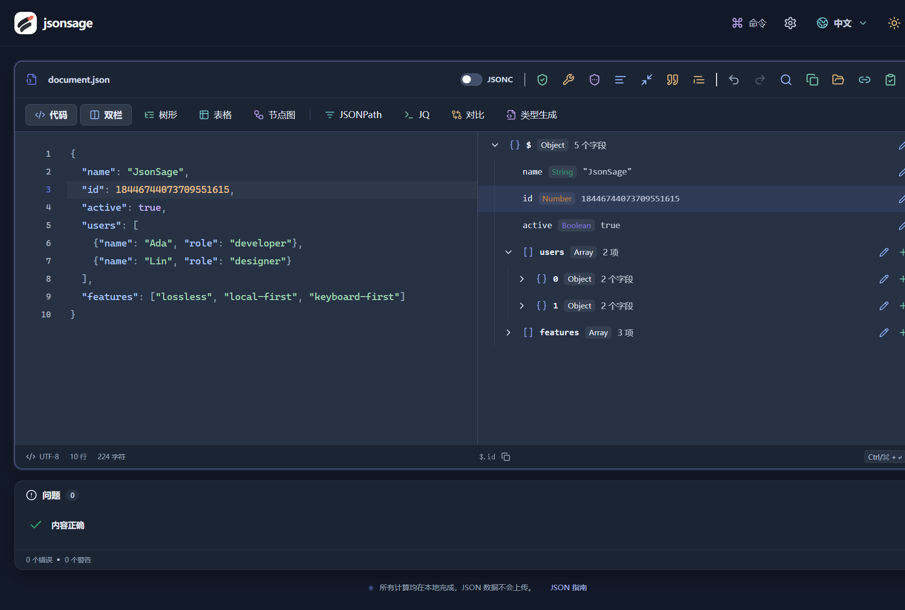

# JsonSage

**See your JSON clearly. Keep every digit. Keep your data local.**

A JSON / JSONC workbench built on CodeMirror 6: edit, query, diff and generate types, all processed locally in your browser.

**英语** · [简体中文](README.zh-CN.md)


**[Live demo](https://jsonsage.dreamlog.xyz/)** · [Quick start](#quick-start) · [功能](#features) · [Shortcuts](#keyboard-shortcuts) · [Deployment](#deployment) · [Contributing](#contributing)


25-second demo · HD MP4

## Why JsonSage

- **Lossless big integers**: formatting, minifying, tree view and diff all keep the original number text, so Snowflake IDs are never silently altered.
- **Handles big files**: virtual viewport plus Web Workers; very large files switch to branch browsing and pagination. Imports up to 128 MiB.
- **Several views**: code, tree, table and node graph, with two-way navigation between code and tree.
- **From error to fix**: line/column diagnostics, one-click repair and structural diff cover the usual debugging loop.
- **Keyboard first**: command palette, customizable shortcuts, and formatting that follows your indent setting.
- **Your data stays in the browser**: no backend, no analytics scripts; installable as a PWA and usable offline.



## Quick start

Requires Node.js 24 LTS and Git. No database, API key or backend service needed.

```sh
git clone https://github.com/zhanpoint/jsonsage.git
cd jsonsage
npm ci
npm run dev
```

打开 <http://127.0.0.1:5174/#workspace>.

**试一试**: paste the JSON below into the code view, press `Ctrl / ⌘ + Enter` to format, then `Alt + 2` for the tree view.

```json
{
  "id": 18446744073709551615,
  "users": [
    { "name": "Ada", "role": "developer" },
    { "name": "Lin", "role": "designer" }
  ],
  "active": true
}
```

> Tip: right-click any field to copy its JSONPath (e.g. `$.users[0].name`). Put the cursor in a string and click **Side preview** to view Markdown, PDF, images, audio/video and Office files in place.

Preview the production build locally (the PWA is only enabled in production builds):

```sh
npm run build
npm run preview -- --host 127.0.0.1 --port 5175
```

## 功能

| Feature | What you can do |
| --- | --- |
| **Code editing** | JSON / JSONC highlighting, folding, bracket matching, find & replace, undo/redo |
| **Multiple views** | Add, edit and delete tree nodes; object arrays become tables; zoomable, pannable hierarchy graph |
| **Diagnostics & repair** | Bilingual error messages with line/column; fixes single quotes, unquoted keys, trailing commas, comments |
| **Structural diff** | Added, removed, changed and type-changed values; key order is ignored for objects |
| **Type generation** | Generate TypeScript, Python, Go and Rust types from a sample |
| **Import & export** | File picker, drag and drop, URL import; export `.json` or copy results |
| **Local history** | Auto or manual save; search, pin, rename; stored only in this browser |
| **Smart paste & redaction** | Detects URLs, JWTs, Base64 and escaped JSON; redacts phone numbers, emails, IPs and other common sensitive fields |
| **Field preview** | Markdown, math, PDF, PPT/PPTX, DOCX, spreadsheets, images, audio/video |

The in-app **文档** entry explains each toolbar command: how it works, examples and limits.

## Keyboard shortcuts

`Mod` is `Ctrl` on Windows / Linux and `⌘` on macOS. Every shortcut can be customized with `Alt + K`.

| Shortcut | Action |
| --- | --- |
| `Mod + K` | Command palette |
| `Mod + Enter` | Format |
| `Mod + F` | Find & replace |
| `Alt + 1 … 4` | Code / Tree / Table / Graph |
| `Alt + 7` / `Alt + 8` | Diff / Type generation |
| `Alt + R` / `Alt + V` / `Alt + M` | Repair / Validate / Minify |
| `Alt + C` / `Alt + Y` / `Alt + X` | Copy formatted / Copy original / Export file |
| `Mod + S` / `Mod + O` | Save / Open file |
| `Alt + H` / `Alt + N` | History / New record |

## Privacy & offline

- Parsing, repair, diff and type generation run locally in the browser. **Your input is never uploaded**, and no third-party compute service or CDN is used.
- Saved history lives in the browser's IndexedDB. It is not synced across devices and not additionally encrypted; clearing site data deletes it, so export anything important.
- `localStorage` only holds preferences such as theme, language, indent and shortcuts.
- When you import a URL, the browser requests that address (without cookies or referrer) and is subject to the target site's CORS policy.
- After the first visit to the production build over HTTPS or localhost, the app works offline.
- JWTs are decoded, not verified. Auto-repair may infer missing content and rule-based redaction may miss custom fields; review results before sharing.

**Precision and large-file limits**

Numbers are kept as raw token via [`lossless-json`](https://github.com/josdejong/lossless-json), never round-tripped through native `JSON.parse` / `JSON.stringify`, which lose big integers.

| Item | Current policy |
| --- | --- |
| File / URL import | Up to 128 MiB, strict UTF-8 check |
| Regular syntax tree | Up to 2M characters, 100,000 nodes, 256 levels; beyond that, branch browsing and pagination |
| Large-file tree | 300 direct children per page |
| Graph / table | Graph up to 300 nodes, table up to 100 columns |
| Search / diff | Up to 5,000 results or diff markers displayed |

Generated types come from your sample and are no substitute for a full schema. Run `npm run benchmark` to measure processing time on ~100 MiB of synthetic data in Node (it measures algorithms, not browser frame rate). More implementation details (in Chinese) are in [docs/details.md](docs/details.md).


## Deployment

The build output is plain static files. Host it on any server with **SPA fallback** and correct MIME types (including WASM). The PWA and some clipboard features need HTTPS (or localhost).

- **Static hosting only**: run `npm run build` and publish `dist/`. Remote file preview requires the file origin to allow CORS.
- **Bundled file proxy**: to preview files that block cross-origin reads, run `npm run file-proxy` on the host (listens on `127.0.0.1:8081`) and forward `/api/preview` to it from Nginx.
- **Docker Compose**:
  ```sh
  cp .env.example .env
  export APP_REVISION=$(git rev-parse HEAD)
  export JSONSAGE_IMAGE=jsonsage:$APP_REVISION
  docker compose up -d --build --wait
  curl -fsS http://127.0.0.1:8088/healthz
  ```

  The container binds to `127.0.0.1` only; expose it publicly through a reverse proxy using the Nginx templates in `deploy/`.
- **Automatic deploys**: pushes to `main` trigger [`CI and Deploy`](.github/workflows/deploy.yml) (checks, tests, build, SSH release, automatic rollback on failure). See [deploy/README.md](deploy/README.md) for server setup and required secrets.

## Contributing

Stack: React 19 · TypeScript · Vite · CodeMirror 6. Heavy computation runs in Workers; shortcuts, toolbar and command palette share `src/lib/commands.ts`.

```text
src/components/   editor, views, menus and dialogs
src/hooks/        state sync and compute-task scheduling
src/lib/          JSON algorithms, paths, import, shortcuts, settings
src/workers/      local compute tasks
server/           same-origin file preview proxy
tests/            feature and deployment regression tests
deploy/           Nginx config and release scripts
scripts/          performance measurement
```

Please report reproducible bugs via [Issues](https://github.com/zhanpoint/jsonsage/issues), or open a PR from a feature branch to `main`. Before submitting, run:

```sh
npm test
npm run check:unused
npm run build
```

## Credits & license

Released under the [MIT License](LICENSE). Third-party dependencies keep their own licenses.

Thanks to [CodeMirror 6](https://codemirror.net/), [jsonc-parser](https://github.com/microsoft/node-jsonc-parser), [lossless-json](https://github.com/josdejong/lossless-json), [jsonrepair](https://github.com/josdejong/jsonrepair), [quicktype](https://github.com/glideapps/quicktype), [Base UI](https://base-ui.com/), [cmdk](https://github.com/pacocoursey/cmdk), [TanStack Virtual](https://tanstack.com/virtual/latest), [React Flow](https://reactflow.dev/), [Vite PWA](https://vite-pwa-org.netlify.app/), [Univer](https://docs.univer.ai/), [SheetJS](https://docs.sheetjs.com/), [Mammoth](https://github.com/mwilliamson/mammoth.js), [PDF.js](https://mozilla.github.io/pdf.js/), [Web-PPT](https://github.com/unStone/web-ppt), [Video.js](https://videojs.org/) and [DOMPurify](https://github.com/cure53/DOMPurify). UI inspired by component designs from [21st](https://21st.dev/).
