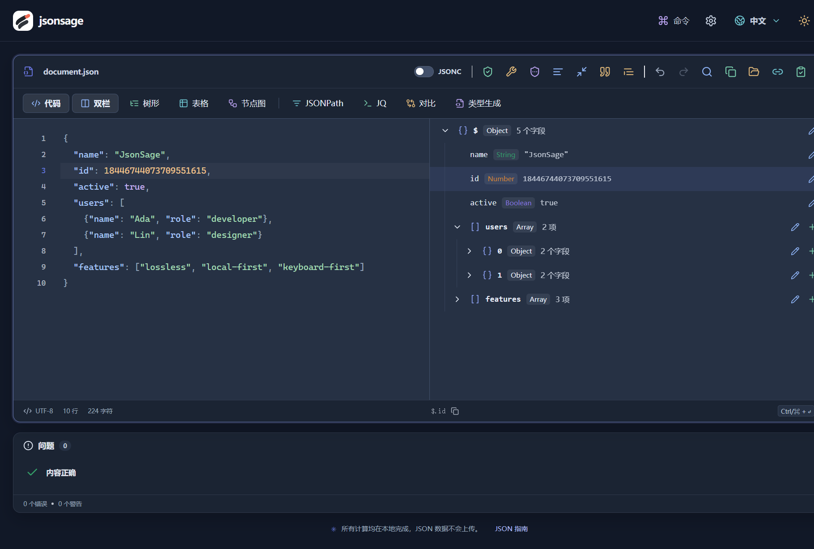

<p align="center">
  
</p>

<h1 align="center">JsonSage</h1>

<p align="center"><strong>看清 JSON，保持精度，数据留在本地。</strong></p>
<p align="center">基于 CodeMirror 6 的 JSON / JSONC 工作台：编辑、查询、对比、生成类型，全程在浏览器本地处理。</p>

<p align="center"><a href="README.md">English</a> · <strong>简体中文</strong></p>

<p align="center"><a href="README.md">English</a> · <strong>简体中文</strong></p>

<p align="center">
  <a href="https://github.com/zhanpoint/jsonsage/actions/workflows/deploy.yml"></a>
  <a href="LICENSE"></a>
  
  
  <a href="https://codemirror.net/"></a>
  <a href="#隐私与离线"></a>
</p>

<p align="center">
  <a href="https://jsonsage.dreamlog.xyz/"><strong>在线使用</strong></a> ·
  <a href="#快速开始">快速开始</a> ·
  <a href="#功能">功能</a> ·
  <a href="#快捷键">快捷键</a> ·
  <a href="#部署">部署</a> ·
  <a href="#参与贡献">参与贡献</a>
</p>

<p align="center">
  
</p>

<p align="center"><sub>25 秒演示 · <a href="docs/demo.mp4">高清 MP4</a></sub></p>

## 为什么用 JsonSage

- **长整数不失真**：格式化、压缩、树形展示和对比都保留数字原文，雪花 ID 不会被悄悄改掉。
- **大文件不卡顿**：虚拟视口 + Web Worker，超大文件自动切换分支浏览和分页，最大支持 128 MiB。
- **多种视角**：代码、树形、表格、节点图随时切换，代码与树形双向定位。
- **从报错到修复**：精确到行列的诊断、一键修复、结构对比，覆盖常见调试流程。
- **键盘优先**：命令面板、可自定义快捷键，格式化遵循你设置的缩进。
- **数据不出浏览器**：没有后端、没有统计脚本；支持 PWA 安装与离线使用。



## 快速开始

需要 Node.js 24 LTS 和 Git。无需数据库、API Key 或后端服务。

```sh
git clone https://github.com/zhanpoint/jsonsage.git
cd jsonsage
npm ci
npm run dev
```

打开 <http://127.0.0.1:5174/#workspace>。

**试一试**：把下面的 JSON 粘贴进代码视图，按 `Ctrl / ⌘ + Enter` 格式化，再按 `Alt + 2` 切到树形视图。

```json
{
  "id": 18446744073709551615,
  "users": [
    { "name": "Ada", "role": "developer" },
    { "name": "Lin", "role": "designer" }
  ],
  "active": true
}
```

> 小技巧：右键任意字段可复制 JSONPath（如 `$.users[0].name`）；光标放进字符串后点 **侧边预览**，可直接查看 Markdown、PDF、图片、音视频和 Office 文件。

本地预览生产版（PWA 仅在生产构建中启用）：

```sh
npm run build
npm run preview -- --host 127.0.0.1 --port 5175
```

## 功能

| 功能 | 你可以做什么 |
| --- | --- |
| **代码编辑** | JSON / JSONC 高亮、折叠、括号匹配、查找替换、撤销重做 |
| **多视图** | 树节点增删改；对象数组自动成表；层级节点图支持缩放平移 |
| **诊断与修复** | 中英文错误说明、行列定位；修复单引号、未引号键、尾逗号、注释 |
| **结构对比** | 区分新增、删除、值修改、类型变更；对象键顺序不同仍视为相等 |
| **类型生成** | 从样本生成 TypeScript、Python、Go、Rust 类型 |
| **导入导出** | 文件选择、拖放、URL 导入；导出 `.json` 或复制结果 |
| **本地历史** | 自动 / 手动保存，搜索、置顶、重命名；仅存于当前浏览器 |
| **智能粘贴与脱敏** | 识别 URL、JWT、Base64、转义 JSON；脱敏手机号、邮箱、IP 等常见敏感字段 |
| **字段预览** | Markdown、公式、PDF、PPT/PPTX、DOCX、表格、图片、音视频 |

工具栏每个命令的机制、示例和边界，见应用顶部的 **文档** 入口。

## 快捷键

`Mod` 即 Windows / Linux 的 `Ctrl`，或 macOS 的 `⌘`。所有快捷键均可在 `Alt + K` 中自定义。

| 快捷键 | 操作 |
| --- | --- |
| `Mod + K` | 命令面板 |
| `Mod + Enter` | 格式化 |
| `Mod + F` | 查找与替换 |
| `Alt + 1 … 4` | 代码 / 树形 / 表格 / 节点图 |
| `Alt + 7` / `Alt + 8` | 对比 / 类型生成 |
| `Alt + R` / `Alt + V` / `Alt + M` | 修复 / 验证 / 压缩 |
| `Alt + C` / `Alt + Y` / `Alt + X` | 复制格式化结果 / 复制原文 / 导出文件 |
| `Mod + S` / `Mod + O` | 保存 / 打开文件 |
| `Alt + H` / `Alt + N` | 历史记录 / 新建 |

## 隐私与离线

- 解析、修复、对比、类型生成均在浏览器本地运行，**不上传输入内容**，不依赖第三方计算服务或 CDN。
- 已保存的历史存于浏览器 IndexedDB，不跨设备同步，也不额外加密；清除站点数据会一并删除，重要内容请另行导出。
- `localStorage` 只保存主题、语言、缩进、快捷键等偏好。
- 主动导入 URL 时，浏览器会请求该地址（不带 Cookie 和 Referrer），并受目标站 CORS 限制。
- 通过 HTTPS 或 localhost 首次打开生产版后，可断网使用。
- JWT 仅解码、不验签；自动修复可能推断缺失内容，规则脱敏可能遗漏自定义字段，分享前请核对。

<details>
<summary><strong>精度与大文件的边界</strong></summary>

数字通过原始 token 与 [`lossless-json`](https://github.com/josdejong/lossless-json) 保存，不经过会丢失长整数的原生 `JSON.parse` / `JSON.stringify`。

| 项目 | 当前策略 |
| --- | --- |
| 文件 / URL 导入 | 最大 128 MiB，严格检查 UTF-8 |
| 常规语法树 | 最多 200 万字符、10 万节点、256 层；超出后切换分支浏览和分页 |
| 大文件树 | 每页 300 个直接子节点 |
| 节点图 / 表格 | 图最多 300 节点，表格最多 100 列 |
| 查询 / 对比 | 最多展示 5,000 个结果或差异标记 |

类型生成基于输入样本，不能替代完整业务 schema。运行 `npm run benchmark` 可在 Node 中测量约 100 MiB 合成数据的处理耗时（衡量算法，不代表浏览器帧率）。更多实现细节见 [docs/details.md](docs/details.md)。

</details>

## 部署

构建产物是纯静态资源，可托管在任何支持 **SPA 回退** 且 MIME 类型正确（含 WASM）的服务器上。PWA 与部分剪贴板功能需要 HTTPS（或 localhost）。

- **仅静态托管**：执行 `npm run build`，发布 `dist/` 即可。远程文件预览要求文件源站允许 CORS。
- **自带文件代理**：如需预览禁止跨域的文件，在主机运行 `npm run file-proxy`（监听 `127.0.0.1:8081`），再用 Nginx 将 `/api/preview` 转发过去。
- **Docker Compose**：

  ```sh
  cp .env.example .env
  export APP_REVISION=$(git rev-parse HEAD)
  export JSONSAGE_IMAGE=jsonsage:$APP_REVISION
  docker compose up -d --build --wait
  curl -fsS http://127.0.0.1:8088/healthz
  ```

  容器只绑定 `127.0.0.1`，公网入口请用 `deploy/` 下的 Nginx 模板反向代理。
- **自动部署**：推送 `main` 会触发 [`CI and Deploy`](.github/workflows/deploy.yml)（检查、测试、构建、SSH 发布，失败自动回滚）。服务器准备与所需 Secrets 见 [deploy/README.md](deploy/README.md)。

## 参与贡献

技术栈：React 19 · TypeScript · Vite · CodeMirror 6。重计算均在 Worker 中执行；快捷键、工具栏和命令面板共用 `src/lib/commands.ts`。

```text
src/components/   编辑器、各视图、菜单与对话框
src/hooks/        状态同步与计算任务调度
src/lib/          JSON 算法、路径、导入、快捷键与设置
src/workers/      本地计算任务
server/           同源文件预览代理
tests/            功能与部署回归测试
deploy/           Nginx 配置与发布脚本
scripts/          性能测量
```

欢迎通过 [Issue](https://github.com/zhanpoint/jsonsage/issues) 反馈可复现的问题，或从功能分支向 `main` 提 PR。提交前请运行：

```sh
npm test
npm run check:unused
npm run build
```

## 致谢与许可证

基于 [MIT License](LICENSE) 开源，第三方依赖保留各自许可证。

感谢 [CodeMirror 6](https://codemirror.net/)、[jsonc-parser](https://github.com/microsoft/node-jsonc-parser)、[lossless-json](https://github.com/josdejong/lossless-json)、[jsonrepair](https://github.com/josdejong/jsonrepair)、[quicktype](https://github.com/glideapps/quicktype)、[Base UI](https://base-ui.com/)、[cmdk](https://github.com/pacocoursey/cmdk)、[TanStack Virtual](https://tanstack.com/virtual/latest)、[React Flow](https://reactflow.dev/)、[Vite PWA](https://vite-pwa-org.netlify.app/)、[Univer](https://docs.univer.ai/)、[SheetJS](https://docs.sheetjs.com/)、[Mammoth](https://github.com/mwilliamson/mammoth.js)、[PDF.js](https://mozilla.github.io/pdf.js/)、[Web-PPT](https://github.com/unStone/web-ppt)、[Video.js](https://videojs.org/)、[DOMPurify](https://github.com/cure53/DOMPurify)，界面参考 [21st](https://21st.dev/) 的组件设计。
